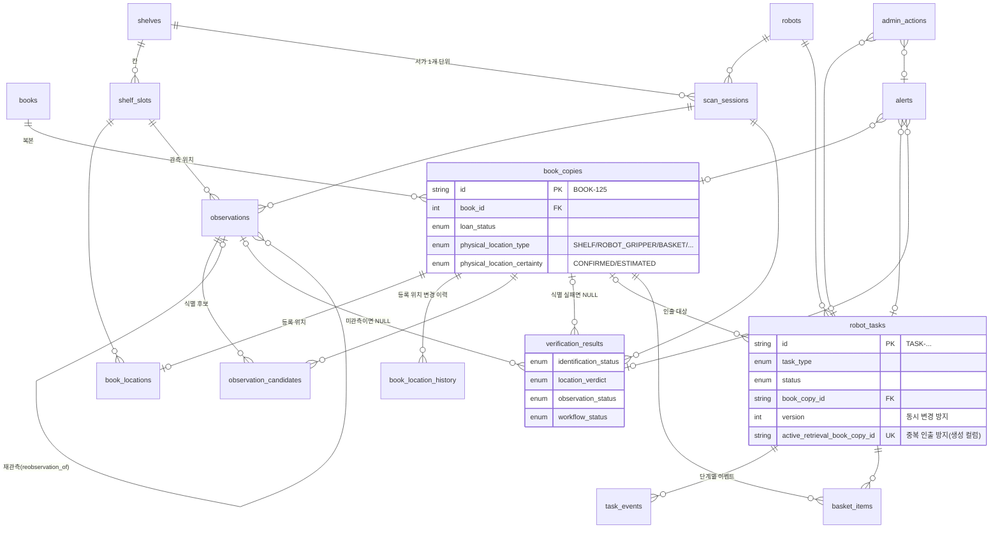

# DB ERD (3단계 초안)

VS Code에서 `Ctrl+Shift+V`(Markdown 미리보기)로 열면 다이어그램이 보인다.
(미리보기에 다이어그램이 안 보이면 "Markdown Preview Mermaid Support" 확장을 설치한다.)

## 위치 3분리

| 개념 | 저장 위치 | 바뀌는 시점 |
|---|---|---|
| 등록 위치 | `book_locations.slot_id` | 관리자가 변경할 때만 (이력: `book_location_history`) |
| 관측 위치 | `observations.slot_id` | AI 관측마다 새 행 |
| 현재 물리 위치 | `book_copies.physical_*` | 로봇 작업 결과 등. 로봇이 확인하지 않았으면 `ESTIMATED` |

## DB 수준 안전장치

| 규칙 | 방법 |
|---|---|
| 같은 도서에 진행 중인 인출 작업 1개만 | `robot_tasks.active_retrieval_book_copy_id` 생성 컬럼 + UNIQUE. 상태가 PENDING_APPROVAL·PENDING·ACCEPTED·IN_PROGRESS·**UNKNOWN**일 때만 값이 채워짐 |
| 회수 전 같은 도서가 바구니에 중복 기록 금지 | `basket_items.uncollected_book_copy_id` 생성 컬럼 + UNIQUE |
| 같은 관측 중복 저장 금지 | `observations.id`(observation_id)가 기본키 |
| 로봇 보고 재전송 중복 저장 금지 | `task_events.idempotency_key` UNIQUE |
| 정의되지 않은 상태 코드 저장 금지 | 상태 컬럼마다 CHECK 제약 |
| 작업 상태 동시 변경 방지 | `robot_tasks.version` (낙관적 잠금) |
| API 키 원문 저장 금지 | `device_credentials.key_hash`만 저장 |

## [가정] 팀원 협의 필요

- 스캔 세션 1개 = 서가 1개 전체 촬영. 칸 단위 범위가 필요하면 확장.
- `robots.current_location`은 형식 미정이라 JSON.
- `task_events.event_type` 이름 목록은 로봇 담당자와 협의.
- 알림 종류·관리자 처리 종류 목록 (`app/core/enums.py`).
- 관리자 계정 체계 (현재 `admin_id`는 문자열).
